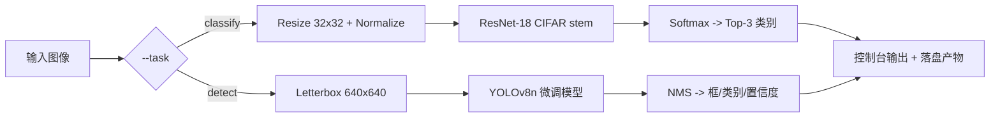
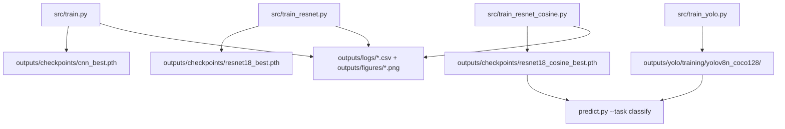
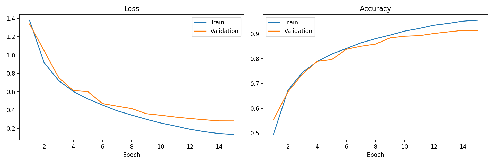
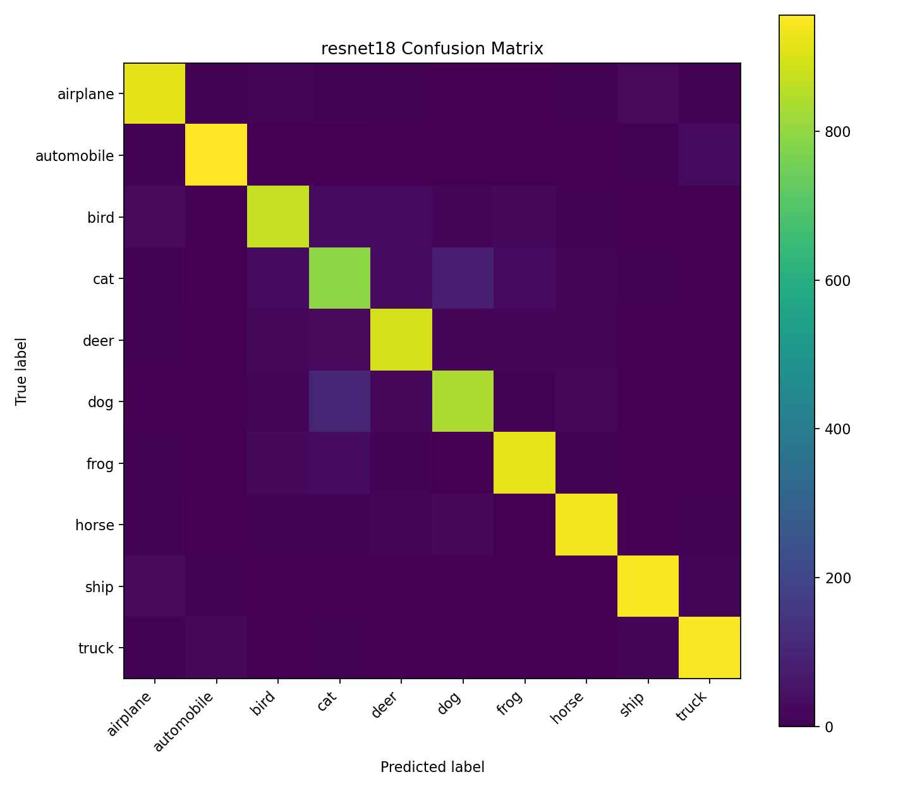
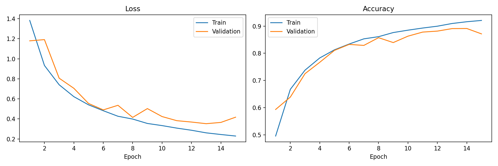
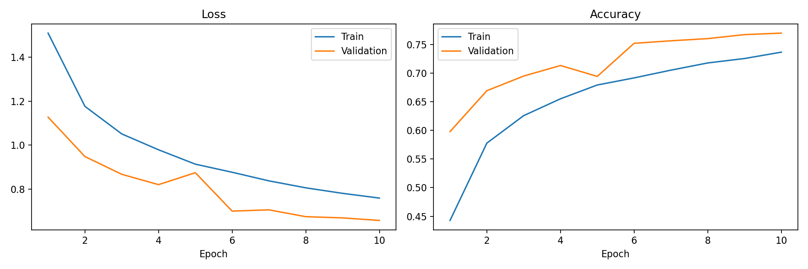
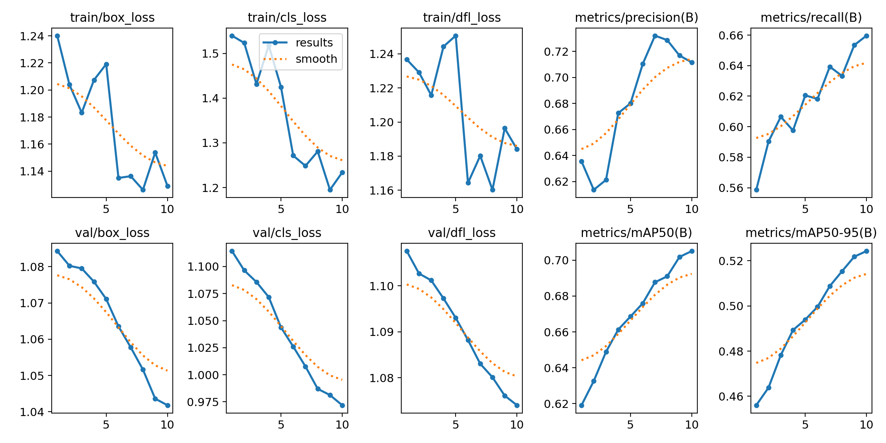
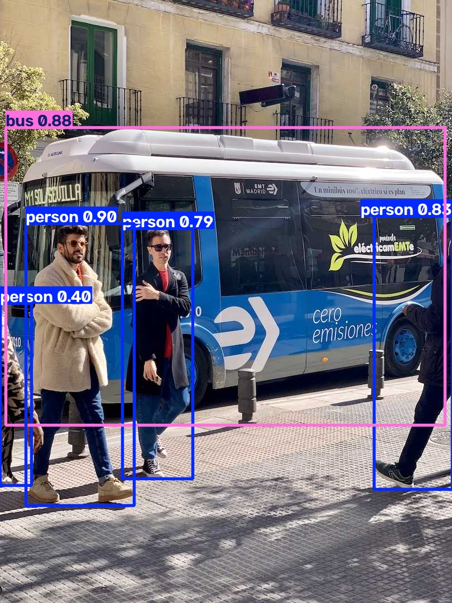
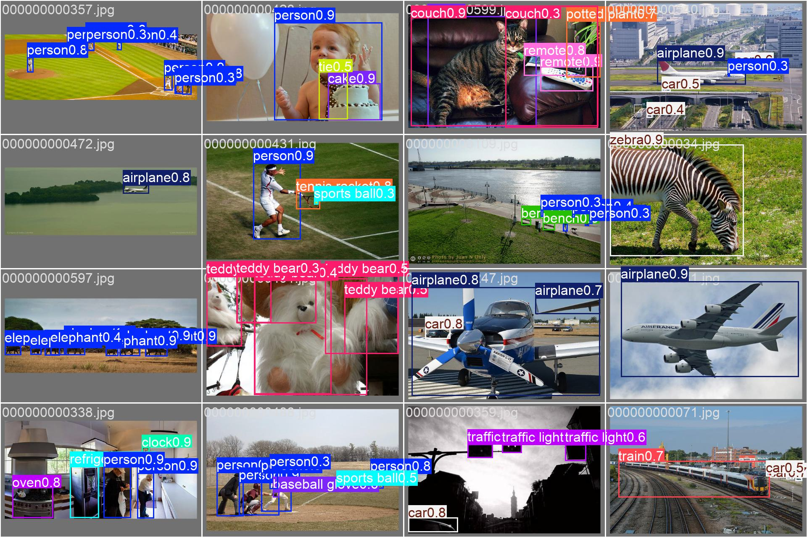
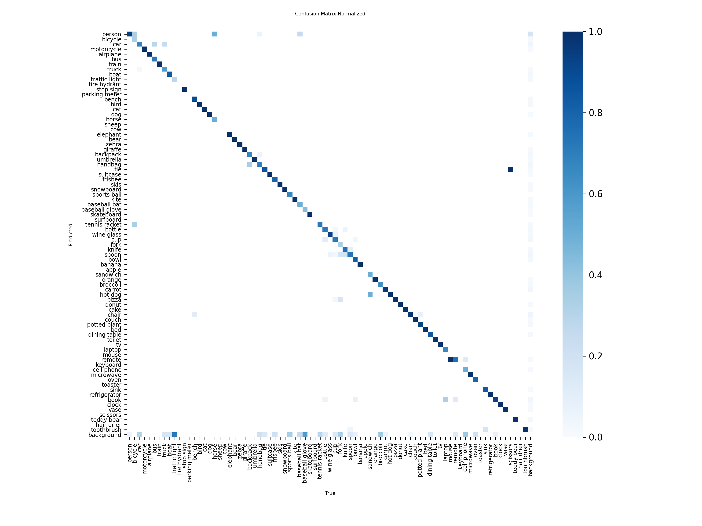

# 计算机视觉：图像分类与目标检测

一个紧凑、可复现的计算机视觉项目，覆盖两个核心任务 —— **CIFAR-10 图像分类**（自建 CNN baseline → ResNet-18 → ResNet-18 + 余弦退火学习率）与 **COCO128 上的 YOLOv8n 目标检测**，并通过统一推理 CLI 提供服务。

<p>
  
  
  
  
  
  
  
</p>

---

## 项目概览

本项目实现了两个标准视觉任务的完整链路，关注点是**受控对比、量化评估与误差分析**，而不是刷榜：

| 任务 | 数据集 | 模型 | 核心指标 |
|---|---|---|---|
| 图像分类 | CIFAR-10（50k / 10k） | ResNet-18（CIFAR 专用 stem）+ CosineAnnealingLR | **90.25% 测试准确率**，90.24% macro-F1 |
| 目标检测 | COCO128（128 张图） | YOLOv8n（COCO 预训练微调） | **70.51% mAP@50**，52.43% mAP@50-95 |

两个模型都由 `predict.py` 统一调用，通过 `--task {classify,detect}` 在同一张输入图上切换任务。

分类部分被刻意设计成一条消融阶梯：

1. 一个从零训练的小型 CNN 作为基线。
2. 换成 CIFAR 专用 stem 的 ResNet-18，验证残差学习的价值。
3. 完全相同的 seed、优化器与训练预算，只把学习率调度换成 **CosineAnnealingLR**，隔离调度器本身的影响。

第 3 步是**受控对比**（只有 scheduler 不同）。第 1 → 2 步**不是** —— CNN 基线同时使用了不同的优化器和 epoch 数，因此这个差距是多个因素叠加的结果（详见[分类实验](#分类实验)）。

---

## 核心特性

- **从零训练的 CNN 基线**：三层卷积 + BatchNorm + Dropout，不使用任何预训练权重。
- **面向 32×32 输入改造的 ResNet-18**：3×3 stride-1 stem，去掉 7×7 max-pool，替换 10 类输出头。
- **学习率调度研究**：在其余配方完全一致的前提下，对比恒定 LR 与 `CosineAnnealingLR`。
- **完整评估体系**：Accuracy、macro-F1、逐类 precision/recall/F1、混淆矩阵、训练曲线。
- **确定性数据划分**：用带 seed 的 `randperm` 生成固定的 45k/5k 训练/验证划分，所有实验看到完全相同的图像。
- **Checkpoint 管理**：保存验证集最优权重，并附带 epoch、val_acc、类别列表与 seed。
- **YOLOv8n 微调**：CUDA 加速，含 mosaic 增强与 AMP（Ultralytics 默认策略）。
- **统一推理 CLI**：两个任务一个入口，控制台可读输出 + 落盘产物。
- **全部产物可追溯**：本文中的每个数字都能对应到 `outputs/` 下的 CSV 日志、PNG 图或 checkpoint。

---

## 技术栈

| 层次 | 工具 |
|---|---|
| 语言 | Python 3.11 |
| 深度学习 | PyTorch、Torchvision（`resnet18`）、Ultralytics（YOLOv8） |
| 指标 | scikit-learn（`accuracy_score`、`f1_score`、`confusion_matrix`、`classification_report`） |
| 可视化 | Matplotlib |
| 加速 | CUDA（NVIDIA GeForce RTX 3060 Laptop GPU） |
| 工具库 | NumPy、Pillow、tqdm |

---

## 项目架构



两条训练链路相互独立，写入同一个 `outputs/` 目录树：



---

## 仓库结构

```text
cv-classification-detection/
├── predict.py                      # 统一推理 CLI（分类 + 检测）
├── requirements.txt
├── README.md
├── src/
│   ├── train.py                    # CNN 基线（Adam，10 epochs）
│   ├── train_resnet.py             # ResNet-18，恒定 LR（AdamW，15 epochs）
│   ├── train_resnet_cosine.py      # ResNet-18 + CosineAnnealingLR（AdamW，15 epochs）
│   ├── train_yolo.py               # COCO128 上微调 YOLOv8n
│   ├── predict_yolo.py             # 预训练 YOLOv8n 冒烟测试
│   ├── predict_yolo_trained.py     # 微调后 YOLOv8n 推理
│   ├── day1_test.py                # 最小单步训练冒烟脚本
│   ├── bus.jpg                     # predict.py 使用的示例输入
│   └── datasets/coco128/           # 本地 COCO128（images/ + labels/）— 不入库
├── data/                           # CIFAR-10，首次运行自动下载 — 不入库
└── outputs/
    ├── checkpoints/                # cnn_best.pth, resnet18_best.pth, resnet18_cosine_best.pth
    ├── logs/                       # 逐 epoch 训练日志（CSV）
    ├── figures/                    # 训练曲线 + 混淆矩阵（PNG）
    ├── predictions/                # classification_result.txt（入库）；detection/ 为推理产物
    └── yolo/
        ├── training/yolov8n_coco128/   # args.yaml, results.csv, results.png, 曲线, weights/
        └── predictions/                # bus_demo/, finetuned_demo/
```

---

## 图像分类

**数据集。** CIFAR-10，10 类、32×32。50000 张训练图用 `torch.randperm(..., generator=manual_seed(42))` 一次性划分为 45000 训练 / 5000 验证。官方 10000 张测试集**只在**最终汇报时使用一次。

**预处理。** 采用 CIFAR-10 通道统计量 `mean=(0.4914, 0.4822, 0.4465)`、`std=(0.2470, 0.2435, 0.2616)`。

**数据增强（仅训练）。** `RandomCrop(32, padding=4)` + `RandomHorizontalFlip()`。验证与测试只用归一化 —— 注意验证子集是从**干净**的 transform 管线取的，因此验证指标不会被增强噪声抬高。

**模型。** `torchvision.models.resnet18(weights=None)`，针对 CIFAR 做两处修改，因为原版 ImageNet stem 对 32×32 输入下采样过猛：

```python
model.conv1   = nn.Conv2d(3, 64, kernel_size=3, stride=1, padding=1, bias=False)
model.maxpool = nn.Identity()
model.fc      = nn.Linear(model.fc.in_features, 10)
```

**损失与 Checkpoint。** 交叉熵；保存验证准确率最优的权重，同时记录 `epoch`、`val_acc`、`classes`、`seed`，最后重新加载做一次性测试集评估。

---

## 分类实验

三次运行共享相同的数据划分、seed 与增强策略，但**并非**共享相同的优化器与 epoch 预算 —— 下面逐行列出每次运行的真实配方，因为这个差异直接影响结论解读。

| 模型 | 优化器 | Epochs | 学习率调度 | 测试准确率 | Macro-F1 |
|---|---|---:|---|---:|---:|
| CNN 基线（`SimpleCNN`） | Adam, lr=1e-3, wd=1e-4 | 10 | 无 | 76.73% | 76.11% |
| ResNet-18 | AdamW, lr=1e-3, wd=1e-4 | 15 | 恒定 | 88.01% | 87.91% |
| **ResNet-18 + CosineAnnealingLR** | AdamW, lr=1e-3, wd=1e-4 | 15 | 余弦，`T_max=15`，`eta_min=1e-5` | **90.25%** | **90.24%** |

### 客观结果

- **CNN → ResNet-18：+11.28 个百分点**测试准确率。残差连接、更深的网络容量、以及更长的训练预算同时生效（Adam/10 epochs vs. AdamW/15 epochs），因此这个差距**不能**单独归因于网络结构。
- **ResNet-18 → ResNet-18 + 余弦：+2.24 个百分点**准确率、**+2.33 个百分点** macro-F1。此处的 seed、优化器、weight decay、数据增强、划分与 epoch 预算全部一致，唯一变量就是学习率调度。
- 换成误差视角，调度这一步把残余误差从 11.99% 降到 9.75%，**相对下降约 18.7%**。
- 两个 ResNet 实验的最优 checkpoint 都出现在 epoch 14（val acc 分别为 89.12% 与 91.44%）；两个实验的最后一个 epoch 都略有回退，这正是 checkpoint 选择机制要拦住的情况。

### 逐类表现（ResNet-18 + 余弦，测试集）

| 类别 | F1 | 类别 | F1 |
|---|---:|---|---:|
| Airplane | 0.9125 | Frog | 0.9220 |
| Automobile | 0.9603 | Horse | 0.9313 |
| Bird | 0.8781 | Ship | 0.9451 |
| **Cat** | **0.7886** | Truck | 0.9429 |
| Deer | 0.8930 | **Dog** | **0.8502** |

十类 F1 求平均 = 0.9024，与报告的 90.24% macro-F1 吻合 —— 可作为指标内部一致性的一次校验。

### 误差分析

- 最弱的两类是 **cat（0.7886）** 与 **dog（0.8502）**，而它们也正是混淆矩阵中非对角权重最大的一对。这是 32×32 分辨率下预期的失效模式：在这个尺度上，猫与狗的毛发纹理、耳形与身体姿态高度相似，且 CIFAR-10 中大量动物目标尺寸小、存在遮挡。
- 最强的两类是 **automobile（0.9603）** 与 **ship（0.9451）** —— 全局形状高度定型、且与背景语境（道路/水面）强相关，这类信息比细粒度纹理更能抵抗降采样。
- 次级混淆（airplane→ship、automobile→truck）在矩阵中可见，但量级小一个数量级；两对都共享细长轮廓与相近的色彩统计。
- *属于推测性解释，非实测结论：* 类别间的这种排序更像是分辨率/纹理瓶颈导致的，而不是类别不平衡（CIFAR-10 测试集每类恰好 1000 张）。这是对证据的一种合理解读，而非已证明的因果结论。

---

## 训练曲线与混淆矩阵

**ResNet-18 + CosineAnnealingLR —— 逐 epoch 损失与准确率。** 约在 epoch 12 之后验证损失趋于平坦，而训练损失继续下降：尾部已开始过拟合，这也是保留 epoch-14 而非 epoch-15 checkpoint 的原因。



**混淆矩阵（测试集，ResNet-18 + 余弦）。** 对角线很强，cat/dog 区块是主要的残余误差。



**ResNet-18 恒定 LR —— 同坐标对比。** 准确率曲线明显更抖、平台更低，正好对应 +2.24 个百分点差距的定性表现。



**CNN 基线训练曲线（10 epochs）。** 收敛更慢、平台更低 —— 与更小的模型容量和更短的训练预算相符。



---

## 目标检测

**数据集。** COCO128 —— COCO train2017 的 128 张子集，在本项目中用于快速验证微调链路，而非作为基准。本次实验使用的副本位于 `src/datasets/coco128/`，与 Ultralytics 上游 `coco128.yaml` 一致，**只包含单一划分目录**（`images/train2017`、`labels/train2017`）。这直接影响指标解读，详见[局限性](#局限性)。

**模型。** `yolov8n.pt`（COCO 预训练的 nano 版本）微调 10 epochs。

**配置**（摘自 `outputs/yolo/training/yolov8n_coco128/args.yaml`）：

| 参数 | 取值 |
|---|---|
| 输入尺寸 | 640 |
| Batch size | 8 |
| Epochs | 10 |
| 设备 | CUDA（`device: '0'`）— NVIDIA GeForce RTX 3060 Laptop GPU |
| 优化器 | `auto`（Ultralytics 自动选择），`lr0=0.01`，`lrf=0.01`，momentum 0.937，wd 5e-4 |
| 数据增强 | mosaic 1.0、HSV 抖动、translate 0.1、scale 0.5、fliplr 0.5；最后一个 epoch 关闭 mosaic（`close_mosaic: 10`） |
| AMP / 确定性 | `amp: true`、`seed: 42`、`deterministic: true` |
| Workers | 0 |

**训练过程。** mAP@50 从 61.91%（epoch 1）升到 70.51%（epoch 10）；mAP@50-95 从 45.60% 升到 52.43%。全部 10 个 epoch 记录在 `outputs/yolo/training/yolov8n_coco128/results.csv`。



---

## 检测评估

最后一个 epoch 的验证指标（逐字摘自 `results.csv`）：

| 指标 | 结果 |
|---|---:|
| Precision (B) | 71.16% |
| Recall (B) | 65.97% |
| mAP@50 | 70.51% |
| mAP@50-95 | 52.43% |

| Epoch | Precision | Recall | mAP@50 | mAP@50-95 |
|---:|---:|---:|---:|---:|
| 1 | 63.55% | 55.87% | 61.91% | 45.60% |
| 5 | 68.01% | 62.05% | 66.86% | 49.40% |
| 10 | 71.16% | 65.97% | 70.51% | 52.43% |

**如何读这些数字。**

- 两列 mAP 到 epoch 10 仍在上升，验证损失也仍在下降；这次运行属于**欠训练**，尚未收敛。增加 epoch（或在更大显存上用更大 batch）很可能让四项指标同时改善。
- mAP@50-95（52.43%）比 mAP@50（70.51%）低约 18 个百分点，这是定位不够紧的典型特征：模型能找到目标，但框的贴合度不足以在高 IoU 阈值下得分。
- Precision 比 Recall 高约 5 个百分点，说明模型偏保守 —— 漏检多于误检。
- COCO128 **不是**基准数据集。仅 128 张图意味着验证集极小，多个类别的样本数只有个位数，几张图的波动就能让 mAP 跳动好几个百分点。这些数字只能说明微调链路是通的，**不能**用来推断模型在完整 COCO val2017 或真实部署中的表现。

---

## 检测可视化

微调后的 YOLOv8n 在示例图上的结果（`outputs/yolo/predictions/finetuned_demo/bus.jpg`）：



训练过程中的验证批次预测 —— 16 张图及预测框：



该子集中出现的 80 个 COCO 类别的归一化混淆矩阵：



---

## 统一推理

`predict.py` 从同一个入口分派到两个模型。两个权重都是**按需加载**，跑一个任务不会为另一个任务付出加载代价。

```bash
# 图像分类（CIFAR-10 输出头，ResNet-18 + 余弦）
python predict.py --task classify --image src/bus.jpg

# 目标检测（微调后的 YOLOv8n）
python predict.py --task detect --image src/bus.jpg --conf 0.25
```

可选参数：`--output <dir>`（默认 `outputs/predictions`）与 `--conf <0-1>`（检测阈值，默认 0.25）。相对图像路径会以仓库根目录为基准解析。

### 分类输出

```text
Top 1: truck        Probability: 0.5868
Top 2: ship         Probability: 0.3883
Top 3: automobile   Probability: 0.0185
```

> **这是一次接口验证，不是一个有效预测。** CIFAR-10 没有 `bus` 类别，且 `bus.jpg` 是街景图，推理前被缩放到 32×32。模型被迫在其十个训练类别内作答，因此 "truck" 只是"最不错误"的标签，而非正确答案。不要把这条输出当作真实场景分类能力的证据。

### 检测输出

| 类别 | 置信度 |
|---|---:|
| Person | 0.8953 |
| Bus | 0.8836 |
| Person | 0.8321 |
| Person | 0.7920 |
| Person | 0.4012 |

**耗时。** 在 RTX 3060 Laptop GPU 上测得**约 11.9 ms** 每张图的网络前向时间。这是**单次本地测量**，仅覆盖网络前向，不含完整端到端预处理（解码、letterbox、归一化）与后处理（NMS、框还原），也不是多次重复试验的平均基准值。

---

## 环境安装

```bash
git clone <your-repo-url>
cd cv-classification-detection

# 推荐使用独立环境
conda create -n cv-tasks python=3.11 -y
conda activate cv-tasks

# 先安装与驱动匹配的 PyTorch CUDA 版本，例如：
# pip install torch torchvision --index-url https://download.pytorch.org/whl/cu121
pip install -r requirements.txt
```

`requirements.txt` 只列项目真实依赖，并给出最小版本约束。PyTorch 的 wheel **有意不写进固定安装行**：正确的 wheel 取决于你的 CUDA 版本，而误装 CPU-only 版本会静默地让 GPU 训练失效。

数据集不入库：

- **CIFAR-10** 首次运行时自动下载（`download=True`）到 `data/`。
- **COCO128** 需放置到 `src/datasets/coco128/`，或把 `src/train_yolo.py` 中的 `data=` 指向你自己的 `coco128.yaml`。

---

## 快速开始

```bash
# 1. 冒烟测试：确认 CUDA 与环境正常
python src/day1_test.py

# 2. 训练最终分类模型（约 15 epochs）
python src/train_resnet_cosine.py

# 3. 微调 YOLOv8n（约 10 epochs）
python src/train_yolo.py

# 4. 跑两个推理任务
python predict.py --task classify --image src/bus.jpg
python predict.py --task detect   --image src/bus.jpg
```

---

## 训练说明

四个训练脚本都是自包含的（不接受命令行参数），输出到 `outputs/`，文件名固定且互不覆盖。

| 脚本 | 模型 | Epochs | 优化器 | 调度器 | 产物 |
|---|---|---:|---|---|---|
| `src/train.py` | `SimpleCNN` | 10 | Adam | — | `cnn_best.pth`、`cnn_history.csv`、`cnn_*.png` |
| `src/train_resnet.py` | ResNet-18 | 15 | AdamW | — | `resnet18_best.pth`、`resnet18_history.csv`、`resnet18_*.png` |
| `src/train_resnet_cosine.py` | ResNet-18 | 15 | AdamW | `CosineAnnealingLR` | `resnet18_cosine_best.pth`、`resnet18_cosine_history.csv`、`resnet18_cosine_*.png` |
| `src/train_yolo.py` | YOLOv8n | 10 | auto | 线性（`lrf=0.01`） | `outputs/yolo/training/yolov8n_coco128/` |

```bash
python src/train.py                 # CNN 基线
python src/train_resnet.py          # ResNet-18，恒定 LR
python src/train_resnet_cosine.py   # ResNet-18 + 余弦调度  <- 最终模型
python src/train_yolo.py            # COCO128 上的 YOLOv8n
```

超参数以模块级常量写在每个脚本开头（`SEED`、`BATCH_SIZE`、`EPOCHS`、`LR`、`VAL_SIZE`），请直接修改那里，而不是传参。

---

## 可复现性

- **随机种子。** 固定 `42`，在每个训练脚本中同时作用于 `random`、`numpy`、`torch` 与 `torch.cuda`。YOLO 额外启用 `deterministic: true`。
- **数据划分。** 45k/5k 划分由 `torch.randperm(len(train_set), generator=torch.Generator().manual_seed(42))` 生成，因此三次分类实验的划分完全一致，且跨机器稳定。
- **基于验证集的模型选择。** 测试指标只在重新加载最优验证 checkpoint 后计算一次 —— 测试集全程不参与训练与 checkpoint 选择。
- **日志产物。** 逐 epoch 历史写入 `outputs/logs/*.csv`（`train_loss`、`train_acc`、`train_macro_f1`、`val_loss`、`val_acc`、`val_macro_f1`）；YOLO 会写出 `results.csv` 与 `args.yaml`，其中包含完全展开的训练配置。
- **预期波动。** 即使固定种子，YOLO 链路中的 cuDNN 非确定性 kernel 与 GPU 浮点非结合性仍可能影响末位小数。建议把 ±0.2 个百分点视为同配置的运行间噪声。
- **硬件。** 本文所有结果均在单张 NVIDIA GeForce RTX 3060 Laptop GPU 上得到；CPU 运行会改变耗时，但指标大致相当。

**数字来源说明。** 分类的测试准确率与 macro-F1 来自训练脚本的控制台输出（CSV 只保存逐 epoch 的训练/验证指标，不含最终测试那一遍）。检测指标取自 `results.csv` 最后一行。逐类 F1 来自 ResNet-18 + 余弦在测试集上的 classification report。

**模型权重。** Checkpoint 由训练脚本生成，不入库（见 `.gitignore`）。要获得权重，直接运行上面的脚本即可 —— 在所列 GPU 上每次运行只需数分钟。因为没有必要，所以本项目不提供任何外部下载链接。

---

## 局限性

- **COCO128 的验证集并不独立。** 本仓库的数据集副本只有单一划分目录，且上游 `coco128.yaml` 把 `train` 与 `val` 都指向 `images/train2017`。因此报告的 70.51% mAP@50 实际上是在模型已经见过的图像上测得的，**偏乐观**，绝不能当作 COCO val2017 性能引用。
- **检测模型欠训练。** 128 张图、10 个 epoch 只是一次链路验证，不是收敛的模型；最后 epoch 时所有指标仍在改善。
- **分类对比只有部分是受控的。** 调度器消融是干净的（seed、优化器、预算全同）；但 CNN → ResNet-18 这一步不是，因为优化器与 epoch 数也不同。
- **32×32 分辨率限制了上限。** CIFAR-10 的原生分辨率是 cat/dog 混淆的硬约束，调学习率解决不了。
- **单 seed 结果。** 每个配置只训练了一次。没有多 seed，低于约 0.5 个百分点的差异无法与噪声区分 —— +2.24 个百分点的调度增益刚过这条线。
- **分类推理不是真实场景分类器。** `predict.py --task classify` 能接受任意图像，但会缩放到 32×32，并把输出限制在十个 CIFAR 类别内。
- **耗时是单次测量**，不是基准测试；且不含预处理与后处理。

---

## 后续改进

- 在完整 COCO（至少是规范的 train/val 划分）上训练 YOLOv8n，并在 COCO val2017 上汇报。
- 把检测训练显著拉长到 10 epochs 以上并配合早停；补充当前模型的逐类 AP 分析。
- 每个分类配置跑 3–5 个 seed，汇报 mean ± std。
- 为分类 CLI 增加 TTA 与 `--topk` 参数。
- 给 PyTorch 训练脚本加入混合精度（目前只有 YOLO 用了 AMP）。
- 导出 ONNX / TorchScript，并测量包含预处理与 NMS 的端到端延迟。
- 增加 `tests/`，覆盖 checkpoint 加载、transform 输出形状与 CLI 参数校验。
- 把四个训练脚本收敛到统一的 `train.py --config` 入口。

---

## 致谢

- CIFAR-10：Krizhevsky, *Learning Multiple Layers of Features from Tiny Images* (2009)。
- ResNet：He et al., *Deep Residual Learning for Image Recognition* (CVPR 2016)。
- YOLOv8 / Ultralytics，以及 COCO128 示例数据集。
- COCO：Lin et al., *Microsoft COCO: Common Objects in Context* (ECCV 2014)。

本项目用于学习与作品集展示。
